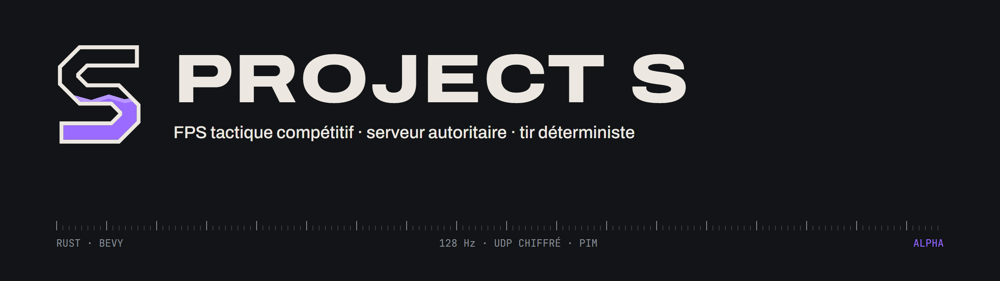

<p align="center"></p>

# Project S — client

Client du FPS tactique compétitif [Project S](https://github.com/SforSkill/Project-s-docs), en Rust : rendu Bevy, interface egui, prédiction réseau, personnages « peinture liquide », et serveur local embarqué pour jouer seul contre des bots.

**Alpha** (dernière version : [Releases](https://github.com/SforSkill/Project-s/releases)). Ce qui est fait et ce qui ne l'est pas : [`docs/status.md`](docs/status.md).

- Jouer : [`QUICKSTART.md`](QUICKSTART.md)
- Client (options, modules, autotest) : [`docs/client.md`](docs/client.md) ; carte du code : [`docs/codemap.md`](docs/codemap.md)
- Périmètre du dépôt : [`SCOPE.md`](SCOPE.md) ; toute la documentation : [`docs/README.md`](docs/README.md)
- Architecture d'ensemble : [Project-s-docs](https://github.com/SforSkill/Project-s-docs/blob/main/ARCHITECTURE.md) ; héberger un serveur : [Project-s-server](https://github.com/SforSkill/Project-s-server)
- Contribuer : [`CONTRIBUTING.md`](CONTRIBUTING.md) ; historique : [`CHANGELOG.md`](CHANGELOG.md)

## Construire

Rust 1.100 (fixé par `rust-toolchain.toml`). Le contenu du jeu (configs, cartes) est dans [Project-s-content](https://github.com/SforSkill/Project-s-content), à cloner à côté de ce dépôt à la version de `.content-version` (ou à désigner par `--data` / `PS_CONTENT_DIR`).

```sh
git clone --branch "$(cat .content-version)" https://github.com/SforSkill/Project-s-content ../Project-s-content
cargo build --release -p ps-client        # target/release/Project-S(.exe)
cargo test --workspace --all-features --release
cargo clippy --workspace --all-targets --all-features -- -D warnings
```

Linux : `libasound2-dev libudev-dev libwayland-dev libxkbcommon-dev`.

## Dépôt

| Dossier | Contenu |
|---|---|
| `crates/ps-client` | binaire `Project-S` : menus, HUD, réglages, entrées, rendu, son, personnages en jeu, serveur local embarqué |
| `crates/ps-netclient` | réseau client sans E/S : prédiction, interpolation, extrapolation ; tests de bout en bout client ↔ serveur |
| `assets/brand/` | logo, icônes, bannière |
| `tools/package.py` | archives de release (binaire + contenu épinglé + licences tierces) |
| `docs/` | documentation du client et liens vers les autres dépôts |

Les dépendances Project S (simulation, transport, serveur, moteur) sont épinglées par tag dans `Cargo.toml`. Pour travailler sur plusieurs dépôts à la fois, un `.cargo/config.toml` local (ignoré par git) redirige ces dépendances vers les clones voisins avec `[patch."https://github.com/SforSkill/<dépôt>"]` ; ne jamais commiter un `Cargo.lock` produit avec ces patches.

## Licence

Code propriétaire, tous droits réservés (voir [`LICENSE`](LICENSE)). Les dépendances tierces sont listées dans `THIRD_PARTY_LICENSES.md`. Aucun asset ne provient d'un jeu existant.
