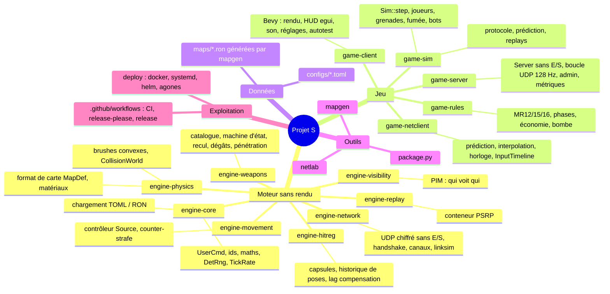

# Carte du code

But : aller droit au bon fichier sans parcourir le dépôt. Index de toute la doc : [`README.md`](README.md) ; vocabulaire : [`glossary.md`](glossary.md). Lire d'abord la ligne de la tâche (« Où chercher »), puis seulement le fichier indiqué, en ciblant le symbole (`rg -n "fn simulate_cmd" crates/`).

## Carte mentale

## Dépendances entre crates

| Crate | Dépend de |
|---|---|
| `engine-core`, `engine-network`, `engine-replay` | aucun crate interne |
| `engine-physics`, `engine-weapons`, `game-rules` | `engine-core` |
| `engine-movement` | `engine-core`, `engine-physics` |
| `engine-hitreg` | `engine-core`, `engine-weapons` |
| `engine-visibility` | `engine-physics` |
| `game-sim` | tous les `engine-*` sauf `engine-visibility`, `game-rules` |
| `game-server` | `game-sim` + `engine-visibility`, `engine-network`, `engine-hitreg` |
| `game-netclient` | `game-sim`, `engine-network`, `engine-movement` |
| `game-client` | `game-netclient`, `game-server` (serveur local embarqué), Bevy |
| `tools/mapgen` | `engine-core`, `engine-physics` |
| `tools/netlab` | `game-server`, `game-netclient`, `game-sim`, `engine-network` |

Règle : `engine-*` ne dépend jamais de `game-*` ; seul `game-client` dépend de Bevy.

## Où chercher

| Tâche | Fichier(s) | Doc | Tests |
|---|---|---|---|
| Valeur de gameplay (vitesse, dégâts, prix, durée de manche) | `configs/movement.toml`, `weapons.toml`, `rules.toml`, `materials.toml` | `docs/configuration.md` | `engine-weapons/tests/catalog.rs` |
| Déplacement, saut, counter-strafe | `engine-movement/src/controller.rs` (`simulate_cmd`, `MoveState`) | `docs/movement.md`, ADR 0002 | `engine-movement/tests/` |
| Collisions, traces, format de carte | `engine-physics/src/world.rs`, `brush.rs`, `map.rs` | ADR 0002, `docs/maps.md` | benches `engine-physics` |
| Nouvelle carte ou modification | `tools/mapgen/src/main.rs` puis `cargo run -p mapgen` (jamais les `.ron` à la main) | `docs/maps.md` | `cargo test -p game-sim` |
| Arme : tir, recul, dispersion, rechargement | `engine-weapons/src/controller.rs`, `spread.rs`, `defs.rs` | `docs/weapons.md` | `engine-weapons/tests/` |
| Dégâts, armure, pénétration | `engine-weapons/src/damage.rs` | `docs/weapons.md` | idem |
| Hitboxes, compensation de latence | `engine-hitreg/src/lib.rs` | `docs/network.md` | tests du fichier |
| Règles de match, économie, bombe | `game-rules/src/lib.rs` | `docs/rules.md` | tests du fichier |
| Tick serveur, tirs, bombe, achats | `game-sim/src/sim.rs` (`Sim::step`, `run_cmd`) | `docs/architecture.md` | `game-sim/tests/sim.rs` |
| Grenades, molotov, fumée | `game-sim/src/grenades.rs`, `smoke.rs` | `docs/grenades.md`, ADR 0004 | `game-sim/tests/sim.rs` |
| Bots | `game-sim/src/bots.rs`, navigation `level.rs` | `docs/bots.md` | `game-sim/tests/sim.rs` |
| Messages réseau du jeu | `game-sim/src/proto.rs` (`ClientMsg`, `ServerMsg`) | `docs/network.md` | `game-netclient/tests/e2e.rs` |
| Prédiction client | `game-sim/src/predict.rs`, `game-netclient/src/lib.rs` | `docs/network.md`, ADR 0003 | `game-netclient/tests/e2e.rs` |
| Entrées sub-tick | `game-netclient/src/input.rs`, `engine-core/src/cmd.rs` | `docs/network.md` | idem |
| Transport, chiffrement, handshake | `engine-network/src/conn.rs`, `crypto.rs`, `endpoint.rs` | `docs/network.md`, `docs/security.md` | tests des fichiers |
| Qui reçoit quoi (anti wallhack) | `engine-visibility/src/lib.rs` | `docs/security.md` | tests du fichier |
| Serveur : snapshots, clients, admin | `game-server/src/server.rs` (sans E/S), `run.rs` (sockets), `config.rs`, `stats.rs` | `docs/deployment.md` | tests de `server.rs` |
| Replays | `engine-replay/src/lib.rs`, `game-sim/src/record.rs` | `docs/replay-format.md` | tests des fichiers |
| Rendu, caméra, effets | `game-client/src/game.rs`, `world.rs` | `docs/client.md` | `--autotest` (`docs/validation.md`) |
| Menus, HUD, réglages, raccourcis | `game-client/src/ui.rs`, `settings.rs` | `docs/client.md`, `QUICKSTART.md` | idem |
| Son | `game-client/src/audio.rs` | `docs/client.md` | — |
| Mesures réseau | `tools/netlab/src/main.rs` | `docs/network-lab.md` | — |
| Archives de release | `tools/package.py`, `.github/workflows/release.yml` | `docs/git-workflow.md` | job `linux` de `release.yml` |
| Déploiement | `deploy/` | `docs/deployment.md` | job `docker` de la CI |

## Fichiers volumineux

À lire par plage, jamais en entier : `game-sim/src/sim.rs` (~2 350 lignes), `game-server/src/server.rs` (~1 480), `game-client/src/ui.rs` (~1 280), `game-client/src/game.rs` (~1 270), `game-rules/src/lib.rs`, `game-netclient/src/lib.rs`. Hors contexte : `Cargo.lock`, `maps/*.ron`, `docs/results/`, `THIRD_PARTY_LICENSES.md` (généré par `tools/package.py third-party`).

Mettre cette carte à jour dans la même PR qu'un ajout ou un déplacement de module.
